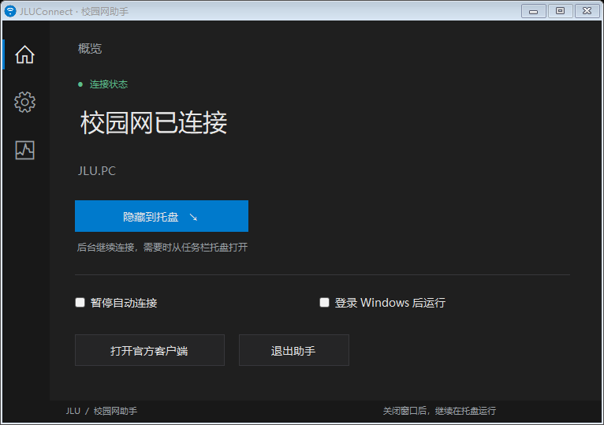

# JLUConnect

**让吉大校园网连接少一点手动操作。** 一个轻量的 Windows 托盘助手，在网络变化和待机恢复后检查官方客户端，必要时触发登录。

[下载 Windows 安装包](https://github.com/Xiaoc7r/JLUConnect/releases/tag/v0.1.0-preview.1) · [所有版本](https://github.com/Xiaoc7r/JLUConnect/releases) · [VPN 配置指南](docs/VPN.md) · [REA 分析笔记](docs/DRMAIN-ANALYSIS.md) · [反馈问题](https://github.com/Xiaoc7r/JLUConnect/issues)



> **当前为预览版，不是吉林大学或 Dr.COM 官方产品。** 依赖已安装的官方客户端和已保存的本人账号。现阶段只适配下文列出的客户端文件；尚未完成所有校区、休眠模式和 VPN 的实机验证。它不破解账号、不替代校园网服务，也不能保证永不断线。

## 能做什么

- 监听网络变化和 Windows 恢复事件，等待网络稳定后检查认证状态。
- 复用官方客户端的登录入口，无需在助手中输入密码。
- 左键托盘打开主页面，右键提供常用操作；一键隐藏后继续运行。
- 暂停状态跨重启保存，支持登录 Windows 后运行。
- 仅在用户登记的网络中自动操作；遇到未知界面、客户端版本或提示框时保守等待。
- 不修改 VPN、系统代理、DNS、网卡地址或全局路由。

**尚不支持：** Mac/Linux/Windows ARM64；把 JLU.WIFI 门户认证当成 DrMain 登录；任意版本的 Dr.COM；自动修复所有 TUN/企业 VPN 策略。界面显示“已认证”来自官方客户端状态，不代表每个网站或代理节点都可用。

## 小白安装：按顺序完成这 5 步

### 1. 先让官方校园网客户端能上网

使用 Windows 10/11 **64 位**，需要 .NET Framework 4.8 和具有管理员权限的本人 Windows 账户。先连接自己正常使用的 **JLU.PC 或校园有线网络**。

从学校提供的渠道安装官方客户端，使用自己的账号手动登录成功，再勾选官方客户端中的“记住密码/保存外网密码”。不要把账号密码发给本项目。学校文档区分 JLU.PC 客户端认证和 JLU.WIFI 网页认证，具体以学校当前说明为准：[吉大入网指南](https://nic.jlu.edu.cn/info/1025/1095.htm)。

如果官方客户端本身无法登录，先解决账号、欠费、网络或官方客户端问题；JLUConnect 无法绕过这些条件。

### 2. 下载正确的文件并解压

进入上方下载页面，在 **Assets** 中下载：

`JLUConnect-0.1.0-preview.1-windows-x64.zip`

**不要选 `Source code (zip)`**，那是给开发者的源码。右键下载包 →“全部解压”，打开解压后的文件夹。不要直接在压缩包里面运行程序。

发布页同时提供 `SHA256SUMS.txt`，需要时可用 PowerShell 的 `Get-FileHash -Algorithm SHA256 文件路径` 核对。当前发布包没有购买代码签名证书；若 Windows 提示未知发布者，请先确认来自本仓库 Release 并核对文件，不要为安装工具关闭系统防护。

### 3. 双击 Install.cmd

系统会请求一次管理员授权。安装器把程序放入 `%ProgramFiles%\JLUConnect`，创建桌面 **JLUConnect** 快捷方式及两个计划任务，然后打开设置页。

需要较高权限是因为本机适配的官方客户端以较高权限运行，Windows 会阻止低权限程序向其发送控制消息。安装不会停止或注销官方客户端，不会修改代理。请不要使用另一个管理员账户代装；标准账户或单位管控电脑目前不在支持范围。

**如果你用过本项目早期的本机定制版，请先退出或卸载旧助手，避免两个助手同时管理登录。** 保留 DrMain，不需要卸载学校客户端。

### 4. 首次确认你自己的校园网络

点击左侧齿轮 → **识别当前网络**：

1. 选择自己确认属于校园网的 Wi-Fi/有线接口。识别结果会显示接口名称、Wi-Fi 名称及网关。
2. 点击“填入设置”，检查内容，再点击“保存设置”。工具不会把识别结果未经确认直接保存。
3. 若官方客户端不在默认目录，点击“浏览…”选择实际的 **DrMain.exe**。可通过原客户端快捷方式的属性找到安装位置。
4. 账号密码仍在官方客户端管理，助手不会提取保存的密码。

**不要照抄别人的网关或 IP。** 出厂网关为空，所以首次安装不会直接认证。切换校区或宿舍后，如果显示“等待已登记的校园网络”，重新识别并确认。Wi-Fi 名称和网关是防误操作条件，并不是可靠的网络身份认证，不能抵御刻意仿冒。

有线用户必须保留学校分配的地址配置；助手不会自动把静态 IP 改为 DHCP。自动识别采用接口类型和常见虚拟网卡名称过滤，只是辅助；不要把 VPN 虚拟接口登记为校园物理网络。Wi-Fi 信息无法读取时，请检查 Windows 权限和接口状态，不能通过随意填网关绕过检查。

### 5. 回到首页，隐藏到托盘

- 不勾选“暂停自动连接”表示允许自动处理。
- 勾选“登录 Windows 后运行”，下次进入桌面后启动。
- 点击蓝色 **隐藏到托盘**。在任务栏的托盘区域（通常是右下角的 `^`）找到蓝色网络图标，左键打开、右键操作。
- “退出助手”只停止助手，保留当前校园网连接。

休眠/关机期间无法保持程序工作，目标是恢复后自动处理。请先在日常自然唤醒时观察，不需要为了测试主动注销正在工作的网络。

## VPN 怎么设置？先看这一表

**不需要填写机场、订阅、节点地址或 API 密钥。换节点通常不需要修改助手。** JLUConnect 通过官方客户端完成认证，官方客户端自己的流量如何走路由，仍取决于系统和 VPN。

| 使用情况 | 你应该怎么做 |
|---|---|
| 不使用代理 | 完成校园网络登记即可 |
| 系统代理 / PAC | 通常先保留原设置；若出问题，先看官方客户端能否手动登录 |
| TUN / 全隧道模式 | 检查 VPN 是否接管校园认证端点、物理网卡路由或 DNS；可能需要该工具的精确绕行规则 |
| 严格 kill switch / 企业 VPN | 可能禁止校园认证所需直连；需通过工具支持的规则或管理员处理，助手不会绕过阻断策略 |
| 分不清模式 | 打开代理软件设置，查看“系统代理 / TUN / 虚拟网卡”等开关；无需提供订阅或节点信息 |

**不要盲目把所有私网或全部 `edu.cn` 加入直连。** 当前版本不自动修改任何代理规则，也没有完成针对具体 VPN 品牌的控制适配。[详细排查步骤 →](docs/VPN.md)

## 常见问题

**显示“客户端权限或版本未通过验证”？**

通过桌面 JLUConnect 快捷方式打开，不要直接双击安装目录中的主程序。确认设置的路径正确。当前严格匹配以下文件 SHA-256（见分析笔记）：DrMain `5.2.1.20191030`、DrClient `5.2.1.20140928`。即使版本号相同，内容不同也会拒绝；不要自行关闭检查。反馈时提供文件版本和 SHA-256，不要上传厂商程序或自己的配置。

**暂停、注销、退出有什么区别？**

“暂停自动连接”保留现有连接，只停止自动处理。“注销并暂停”会确实断开校园认证，位于诊断页及托盘菜单；不要在需要联网的任务中随意使用。取消暂停或“连接 / 恢复自动”恢复管理。助手观察到官方注销确认框时也会暂停；若你随后取消了官方注销，需要手动取消助手的暂停。直接退出助手不注销。

**为什么没有立即重连？**

有网络稳定等待和有限退避；未知提示框、账户异常、未知版本、未登记网络都会阻止自动操作。官方客户端可能弹出需要本人处理的提示。查看左侧诊断，再打开官方客户端确认，不要连续反复点击登录。

**是否轻量？**

原生 WinForms 托盘程序，没有 Electron、浏览器或 AI 常驻；不依赖 REA。早期本机版本观测到助手工作集约 49 MB，这不是当前发布版在所有环境下的保证，也不包含官方客户端开销。

**怎样升级或卸载？**

升级：解压新版包，运行 `Install.cmd`；安装器只重启助手，保留用户配置和自启动偏好。卸载：双击发布包中的 `Uninstall.cmd`，删除助手任务、桌面入口和安装文件，保留官方客户端、当前连接及本机配置。若要清除配置，可在退出后手动删除 `%LOCALAPPDATA%\JLUConnect`。不要误删 Drcom 目录。

## 有用的 DrMain / REA 分析

我们使用 **REA 6.8.0** 对官方程序的副本做静态检查，得到以下工程线索：

1. 样本是 **32 位 Windows PE**。DrMain 界面之外，还有 DrClient 和独立认证 DLL。
2. DrClient 按序号导入 `drauthsvr.dll` 的启动、停止、配置和本地消息相关导出。它们适合作为后续研究边界，但不是公开 SDK，名字不能证明参数或副作用。
3. 某认证模块导入 `wpcap.dll` / `packet.dll`，不能简单把整个客户端当成一个网页登录请求。
4. 后续本机窗口观察发现，“登录 / 注销”控件会随状态变化，托盘隐藏与离线不是一回事，还存在独立登录窗和注销确认框。

因此首版采用**严格限定客户端版本的窗口控件适配**，通过已识别按钮的命令让官方程序完成认证，未调用未知认证 DLL，也未重实现协议。公开笔记保留证据类型、序号映射和限制，不包含账号、私人路径、原始日志、抓包或厂商二进制。[完整的精简分析 →](docs/DRMAIN-ANALYSIS.md)

## 隐私与开源范围

- 不收集账号、密码、订阅、节点信息；没有遥测或云端账号系统。
- 配置和轮转日志留在本机。配置中包含你登记的网络信息和安装路径；公开反馈前请脱敏，别上传整个配置目录。
- 本仓库只发布原创助手代码、安装脚本、文档和生成的界面示意图。没有上传开发者个人配置、桌面截图、官方客户端副本或完整 REA 原始输出。
- MIT 许可证仅覆盖本仓库代码。Dr.COM、学校客户端及 REA 属于各自权利人，本项目不重新分发它们。

## 从源码构建

Windows x64 / .NET Framework 4.8，使用 PowerShell：

```powershell
git clone https://github.com/Xiaoc7r/JLUConnect.git
cd JLUConnect
powershell -NoProfile -ExecutionPolicy Bypass -File scripts/build.ps1
```

产物位于 `dist/`，包括 Windows ZIP 和 SHA-256 文件。构建会执行纯离线测试，**不会安装助手、注销校园网、修改代理或发送登录请求**。无需 Node、npm、REA、Visual Studio 或第三方 NuGet 包。[开发说明](docs/DEVELOPMENT.md)

```text
src/                 主程序、原生界面、桌面启动器
scripts/             构建、安装、卸载
tests/               离线网络登记与配置测试
assets/              原创图标和合成界面图
docs/                VPN、分析和开发说明
.github/workflows/   Windows 构建与发布
```

欢迎通过 Issue 提供脱敏后的环境信息。预览版仍需不同校区、客户端和 VPN 使用者的反馈；请勿把任何尚未复现的场景当作已验证支持。
